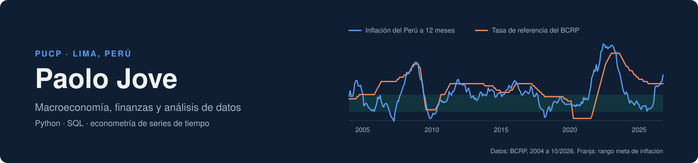
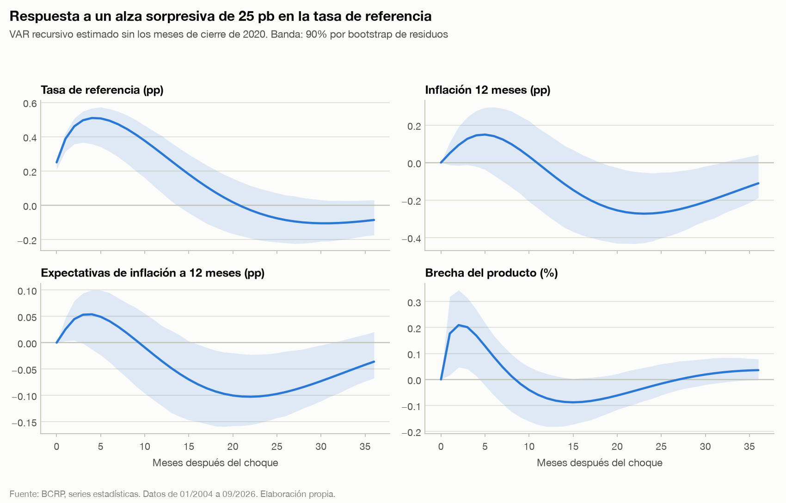
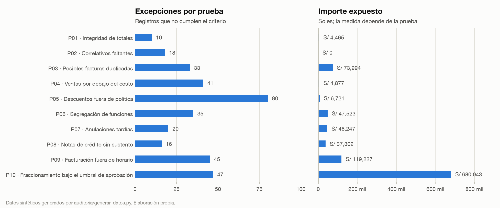
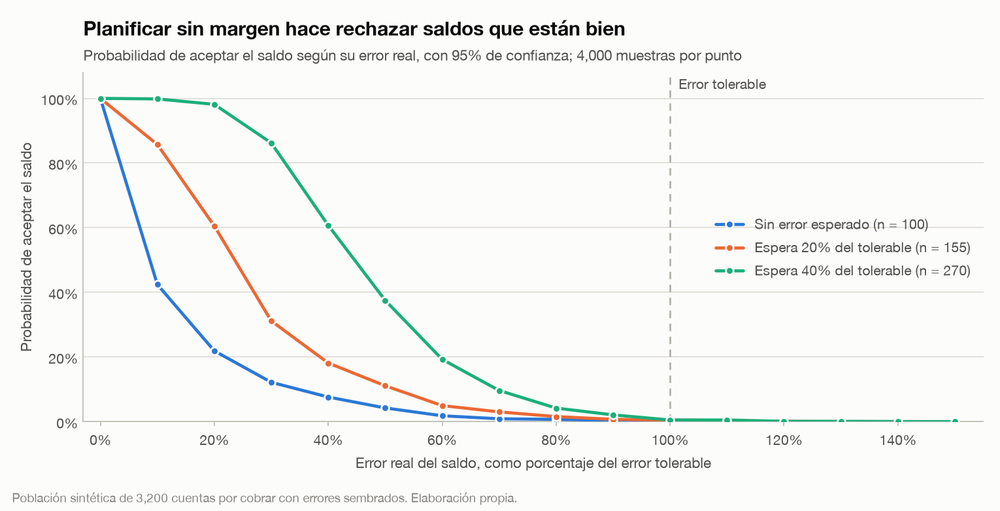
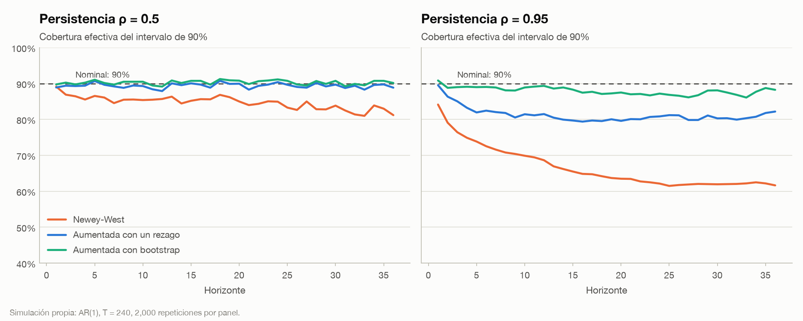

  

Estudiante de 8.º semestre (por iniciar el 9.º) en la **Pontificia Universidad Católica del Perú**. Cursé **FM350 Advanced Corporate Finance** de forma presencial en la **London School of Economics (LSE)**, en Londres. Aquí publico proyectos de macroeconomía, finanzas y análisis de datos aplicados al Perú.

**Busco prácticas pre-profesionales en Lima** en finanzas corporativas y banca de inversión, estudios económicos, gestión de riesgos, análisis de datos y auditoría interna.

[LinkedIn](https://www.linkedin.com/in/paolo-jove-085647127)

## Proyectos

<table>
  <tr>
    <td width="44%"></td>
    <td>
      <h3><a href="https://github.com/paolojoveal/portafolio-finanzas">portafolio-finanzas</a></h3>
      Siete proyectos con datos del BCRP y de mercado: valorización DCF con su modelo en Excel, optimización de portafolio, VaR con backtesting, política monetaria, scorecard de crédito, tablero macro y finanzas corporativas (LBO, M&amp;A, venture capital).  
      <b>Un resultado:</b> el BCRP responde a las expectativas de inflación (coeficiente de 3.0), no a la inflación del mes (1.0).  
      <code>Python</code> <code>statsmodels</code> <code>scikit-learn</code> <code>Streamlit</code>
    </td>
  </tr>
  <tr>
    <td></td>
    <td>
      <h3><a href="https://github.com/paolojoveal/auditoria-analitica-ventas">auditoria-analitica-ventas</a></h3>
      Diez pruebas de auditoría interna en SQL sobre el 100% de las ventas de una distribuidora ficticia, con informe, papeles de trabajo en Excel y un análisis de qué usuarios concentran las excepciones.  
      <b>Un resultado:</b> detectar es la parte fácil. La prueba de fraccionamiento marca 47 casos y 17 son operaciones legítimas.  
      <code>SQL</code> <code>SQLite</code> <code>Python</code> <code>Excel</code>
    </td>
  </tr>
  <tr>
    <td></td>
    <td>
      <h3><a href="https://github.com/paolojoveal/muestreo-auditoria">muestreo-auditoria</a></h3>
      Muestreo estadístico para auditar lo que no se puede revisar completo: atributos para probar controles y unidad monetaria con cota de Stringer para probar saldos, con un caso de principio a fin.  
      <b>Un resultado:</b> una muestra de 154 partidas sin un solo error no prueba que el saldo esté limpio. Solo permite afirmar que el error no supera S/ 221 105.  
      <code>Python</code> <code>estadística</code> <code>auditoría</code> <code>Monte Carlo</code>
    </td>
  </tr>
  <tr>
    <td></td>
    <td>
      <h3><a href="https://github.com/paolojoveal/proyecciones-locales">proyecciones-locales</a></h3>
      El estimador de proyecciones locales escrito desde cero, una simulación de Monte Carlo sobre sus intervalos de confianza, el bootstrap que los corrige y una aplicación al efecto del precio del cobre en la economía peruana.  
      <b>Un resultado:</b> con series persistentes, un intervalo tradicional «de 90%» contiene el valor verdadero 62% de las veces. Con bootstrap, 88%.  
      <code>Python</code> <code>NumPy</code> <code>econometría</code> <code>Monte Carlo</code>
    </td>
  </tr>
</table>

## Cómo trabajo

- **Los datos se verifican antes de usarse.** Cada serie del BCRP se comprueba contra su nombre oficial al descargarla, y una descarga incompleta no se guarda.
- **Cada cálculo tiene una prueba con respuesta conocida.** Los cuatro repositorios corren sus pruebas en GitHub Actions: comparaciones con `statsmodels`, fórmulas cerradas y datos simulados con parámetros conocidos.
- **Los límites van escritos.** Cada README dice qué supuestos sostienen el resultado y qué no se puede concluir de él.

## Herramientas

Python (pandas, NumPy, statsmodels, scikit-learn, matplotlib, Plotly, Streamlit) · SQL · Git y GitHub Actions · Excel
